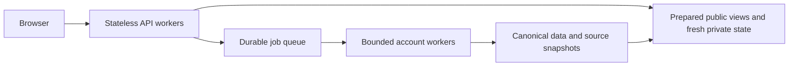

# Architectural performance investigation

Baseline: `78c85cdb`, isolated branch `codex/anylist-stress-test`.
Raw observations: ignored `.cloud-runtime/anylist-stress/architecture/`.
No beta/production deployment or database changes.

## Largest confirmed defect: account preparation on the API loop

`core.sync_reconciliation.initialize()` compared every saved source-library
record with every candidate `Media` object. A library with 10,000 distinct native
IDs could execute 100 million comparisons. This synchronous loop ran inside the
primary API process, despite the surrounding function being `async`.

The fix indexes candidates by native identity, then matches each record to only
its matching movie/series rows. Missing, duplicate, typed and untyped source
records preserve the original membership semantics. It also reads the four entry
fields needed for comparison and three media identity fields, rather than full
ORM objects containing notes and provider JSON.

Authenticated HTTP measurements on the VPS used the actual old/new initializer,
normal session validation and the same disposable PostgreSQL records. Two samples
per arm/size, baseline → final → final → baseline; medians below:

| Library size | Old preparation | Final preparation | Old CPU | Final CPU | Concurrent primary health, old / final |
| --- | ---: | ---: | ---: | ---: | ---: |
| 1,000 | 335 ms | 39 ms | 326 ms | 29 ms | 294 / 12 ms |
| 5,000 | 7,497 ms | 125 ms | 7,481 ms | 108 ms | 7,130 / 44 ms |
| 10,000 | 29,196 ms | 467 ms | 29,160 ms | 443 ms | 28,822 / 279 ms |

The 10,000-item preparation is about 62× faster in these observations. A health
request was delayed for almost 29 seconds by the old initializer, while PostgreSQL
was not executing a correspondingly slow query. This can disrupt unrelated users:
the primary also accepts requests, authenticates pages and proxies read workers.
The remaining approximately 0.28-second health delay still supports moving large
account jobs out of the HTTP event loop.

Local PostgreSQL measurements independently found 14.87 → 0.257 seconds from the
index alone at 10,000 items. Both arms executed eight SQL statements and made no
provider calls. A separate indexed-only versus focused-column comparison with
4 KiB of metadata and 1 KiB of notes per item measured 0.463 → 0.135 seconds at
10,000 items, still eight statements. SQL observation confirmed that full metadata
and notes columns are no longer selected. That fixture avoids at least 51 MB of
unused result fields. This is reduced read work; stored metadata/notes remain intact.

All membership, local-library and comparison-entry fingerprints match. Regression
checks cover shared movie/series native IDs, missing mappings, duplicate records,
source ordering and a linear bound on identity reads. Existing reconciliation and
recovery tests protect manual edits, cancellation, conflicts and delivery commits.

These are preparation measurements, not total provider sync time or a 62× increase
in whole-app capacity. The HTTP probe disables periodic jobs to isolate the
algorithm. It executes the trusted baseline `initialize()` function body against
current dependencies/schemas, rather than replaying an entire historical app.

## Important gap in the earlier capacity workload

Manual full Jellyfin pulls, the mapper, season/statistics processing and other
periodic jobs were active. Scheduled account pulls use a five-minute initial wait
in `_auto_sync_scheduler`. The new normal profiling run's primary lived 169
seconds; the earlier short timed levels likewise did not exercise that tick.
The synthetic media-server library contained 48 films.

Consequently those results did not establish large-account reconciliation cost,
scheduled account bursts, complete long-history imports, or every provider's sync
behavior. Configuring scheduled accounts in a fixture is not evidence that their
timer ran. Keep the new large-library probe alongside the mixed-load benchmark.

## The remaining account-job architecture

`account_sync.run_account_pull()` prepares the account before `_run_provider()`
performs its remote change check. Even a later verified unchanged result can pay
for full-account preparation first. Preparation loads entries, completed watches,
source snapshots, collections and library intents across the account.

The media-server admission gate is inside the provider runners. Account-level
preparation/finalization happens outside that gate. The five-minute scheduler
can launch multiple account cycles with `asyncio.create_task`; a one-slot server
setting therefore does not bound all account reconciliation work. Post-response
FastAPI tasks also run in the API process. Returning a response does not make
their CPU independent of other requests.

The next account architecture should claim durable, bounded work **before**
preparation, check supported remote change markers before reconstructing state,
and fetch/apply affected records in batches. Providers without a complete change
marker still need conservative pulls/audits. Put account work in supervised worker
processes with leases, cancellation, retry and idempotent outbox delivery, while
preserving the current three-way comparison and concurrent-edit protection.
Do not just wrap the parent in the existing provider semaphore: its children
acquire that semaphore too and a one-slot configuration would deadlock.

There is additional snapshot-copy amplification in `_raw_progress`: it copies
the existing progress dictionary for each observation. Grouping by connection and
writing each snapshot once is a further candidate, not a measured improvement in
this change. Likewise, full-account finalization still scans entries even for a
small delta. These deserve large-history/delta benchmarks before redesign.

## Largest remaining target for ordinary warm browsing

A normal rendered page fetches `/auth/me`, `/auth/settings`,
`/tracking/preferences`, `/profile/me` and `/tracking/recent-events` for its shared
shell. In the 80-user trace, these five calls contributed exactly **20 SQL
statements per page**, separate from title/game data; screen pages also checked
connections. Much of this reauthenticates and reloads the same viewer data.

The navigation badge requests the full notification response. `recent_events()`
performs expiry cleanup, loads review/media data, traverses delivery queues,
reads up to 200 full sync-job records and projects active imports. In the fixture
it costs 11 SQL statements even for a mostly empty inbox. The browser's attention
component and notification lifecycle make further requests not executed by this
HTTP/SSR-only load generator.

Diagnostic CPU samples in the primary process:

| Work | At 80 active users | At 120 active users |
| --- | ---: | ---: |
| Five page-shell GET handlers, owning task | 29.3% | 33.4% |
| Full notification handler alone, owning task | 14.4% | 16.0% |
| Work after response, including syncs and edit delivery | 20.2% | 16.7% |
| Named primary periodic jobs | 3.5% | 4.6% |

These are shares of primary-process sampled CPU, not the entire VPS. Child tasks,
HTTP proxy work, loop callbacks and API reader processes are separate. The
catalogue process used approximately 0.2 CPU cores, with its mapper, provider
admission and source cache prominent. Removing all automatic work would not
explain or eliminate the remaining request cost.

The surviving reader's profile shows request work spread across title details,
searches, people, catalogue details, lists and browse, rather than one dominating
endpoint. SQLAlchemy appears in 79.2% of its stacks and 67.5% of primary stacks;
these overlapping stack categories are not exclusive ORM overhead percentages.
Asyncpg appears in 2.8% and 4.7%. Query construction, ORM population and result
processing are better targets than replacing PostgreSQL or changing drivers.
One reader is deliberately killed by the recovery probe, so its final profile
does not exist; the reader percentages describe the surviving process.

The strongest broader redesign is a read side that serves prepared, versioned
public metadata plus a small fresh private overlay, and one lightweight private
page context instead of many settings/inbox calls. Separate badge/attention data
from the operational delivery-queue projection. Maintain read projections when
their source data changes; preserve notification expiry, policy/country keys,
immediate authorization revocation and per-viewer isolation. Provider-payload
caching alone does not cache these page compositions.

This direction has a larger scope than a new cache TTL. Eliminating the page-shell
cost alone cannot deliver a tenfold whole-system gain: it is one part of one
process. Broader read-path redesign, less account work and an adequate/reserved
CPU budget all matter for the 1,000-active-user goal. No such capacity is claimed.

## Documentation and verification

[SQLAlchemy's performance FAQ](https://github.com/sqlalchemy/sqlalchemy/blob/rel_2_0_49/doc/build/faq/performance.rst)
recommends profiling object/result processing and selecting focused columns for
read paths. That matches the measured column-projection improvement here.
[Python's asyncio guidance](https://github.com/python/cpython/blob/v3.13.14/Doc/library/asyncio-dev.rst)
explains why synchronous CPU work delays concurrent tasks;
[its executor guidance](https://github.com/python/cpython/blob/v3.13.14/Doc/library/asyncio-eventloop.rst)
distinguishes CPU work suitable for processes from blocking I/O. Moving work to
another process improves isolation but does not remove the work or create CPU
capacity; the algorithm/read changes remove work first.

56 focused real-PostgreSQL/unit checks passed after the final column projection.
18 paired profile-list/activity samples match identities/order, payloads,
pagination/pending state, SQL counts and provider requests. These are neighboring
compatibility controls; they do not measure account preparation.
Full discovery ran 3,675 tests with the same existing one failure and 68 errors
(1,230 skips), and no new failure identities. Ruff and whitespace checks pass.

Normal mixed traffic and the HTTP probe ran in a private network namespace against
disposable PostgreSQL. All production guard probes returned 200, worst 68 ms.
The application's real HTTP/auth/SQL path was used, with synthetic source data.
Periodic jobs were enabled for the attribution trace and disabled only for the
isolated initializer comparison. Tested source hashes and inactive unit statuses
were saved with artifacts. The dedicated lab and test container were removed.
